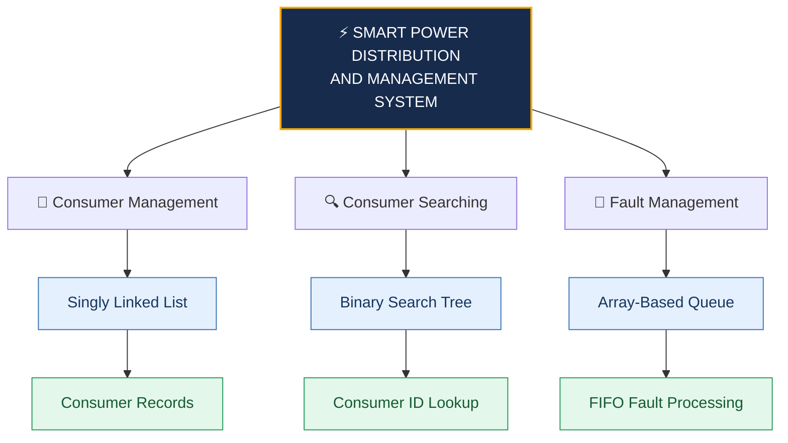
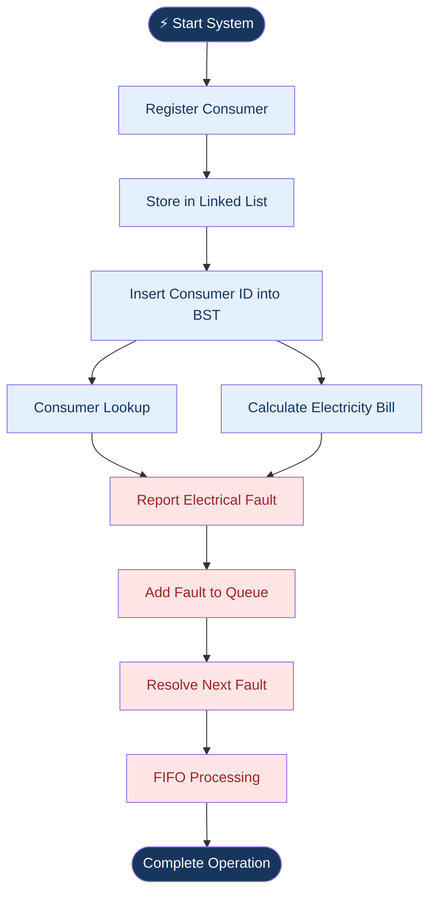

# ⚡ SMART POWER DISTRIBUTION AND MANAGEMENT SYSTEM

<div align="center">


### ⚡ Intelligent Electricity Distribution Management Using C

<p>


</p>

**Efficient Consumer Management | Smart Fault Handling | Automated Billing**

</div>

---

## 🌟 About The Project

The **Smart Power Distribution and Management System** is a C-based console application developed to simulate electricity distribution and management operations.

The project demonstrates the practical application of fundamental Data Structures to manage electricity consumers, search consumer records, handle electrical faults, and calculate electricity bills.

It integrates three major data structures:

- 🔗 Singly Linked List
- 🌳 Binary Search Tree (BST)
- 🚨 Array-Based Queue (FIFO)

## 🚀 Key Features

<table>
<tr>
<td width="50%">

### 👥 Consumer Management
Register and maintain consumer information, including ID, name, location, and energy consumption.

</td>
<td width="50%">

### 🔍 Smart Consumer Search
Search registered consumers using Binary Search Tree operations.

</td>
</tr>
<tr>
<td width="50%">

### 🚨 Fault Management
Report electrical faults and process them in FIFO order.

</td>
<td width="50%">

### 💰 Automated Billing
Calculate electricity bills based on units consumed.

</td>
</tr>
<tr>
<td width="50%">

### ⚡ Power Distribution
Simulate electricity consumer and distribution management operations.

</td>
<td width="50%">

### 📊 Queue Management
Manage up to 10 pending electrical fault requests.

</td>
</tr>
</table>

---

## 🧠 Data Structures Architecture

The system uses three fundamental data structures to organize and process information efficiently.



## 🔗 1. Singly Linked List – Consumer Management

Used to dynamically store registered electricity consumer records.

**Structure:**

```text
       HEAD
         |
         v
+---------+---------+------+
| Consumer 101      | NEXT | ---->
+---------+---------+------+
                            |
                            v
                    +---------+---------+------+
                    | Consumer 102      | NEXT | ---->
                    +---------+---------+------+
                                                  |
                                                  v
                                                 NULL
```

**Purpose:**
- Dynamic consumer registration.
- Store consumer details.
- Maintain multiple consumer records.

## 🌳 2. Binary Search Tree – Consumer Lookup

Used to organize consumer IDs and search for registered consumers.

**Example BST:**

```text
                 50
                /  \
              30    70
             / \    / \
            20 40  60 80
```

**Purpose:**
- Organize consumer IDs.
- Search consumer records.
- Apply BST insertion and searching operations.

## 🚨 3. Array-Based Queue – Fault Management

Used to manage electrical faults according to the First In, First Out (FIFO) principle.

**Queue Representation:**

```text
FRONT                                  REAR
  |                                      |
  v                                      v
+-----+-----+-----+-----+-----+-----+
| 101 | 102 | 103 | 104 | 105 |     |
+-----+-----+-----+-----+-----+-----+

       FIRST IN → FIRST OUT
```

**Operations:**

| Operation | Description |
|---|---|
| Enqueue | Add a new fault |
| Dequeue | Resolve the first reported fault |
| FIFO | First reported, first resolved |
| Capacity | Maximum 10 faults |

---

## 🔄 System Workflow



## 💰 Electricity Billing System

The system calculates electricity charges based on energy consumption.

**Billing Formula:**

```text
Electricity Bill = Units Consumed × Rate Per Unit
```

| Billing Details | Value |
|---|---:|
| Energy Consumption | 100 Units |
| Rate Per Unit | ₹5 |
| Total Electricity Bill | ₹500 |

---

## ⚙️ Project Configuration

| Configuration | Value |
|---|---|
| Programming Language | C |
| Maximum Fault Queue | 10 |
| Billing Rate | ₹5 per unit |
| Consumer Storage | Singly Linked List |
| Consumer Searching | Binary Search Tree |
| Fault Management | Array-Based Queue |
| Application Type | Console-Based |

## 🛠️ Technology Stack

<div align="center">


</div>

- **C Programming:** Application development.
- **GCC:** Program compilation.
- **Structures:** Organizing consumer and BST records.
- **Pointers:** Dynamic memory management.
- **Data Structures:** Linked List, BST, and Queue.

---

## 💻 Installation & Execution

### Prerequisites

- GCC Compiler
- Visual Studio Code or any C-supported IDE
- Windows / Linux

### 1. Clone the Repository

```bash
git clone https://github.com/rguganrajkumar-coder/smart-power-distribution-and-management-system.git
```

### 2. Navigate to the Project Folder

```bash
cd smart-power-distribution-and-management-system
```

### 3. Compile the C Program

```bash
gcc smart_power_distribution.c -o smart_grid
```

### 4. Execute the Program

**Windows:**

```bash
smart_grid.exe
```

**Linux:**

```bash
./smart_grid
```

---

## 🎯 Learning Outcomes

- Practical implementation of Data Structures.
- Understanding structures and pointers in C.
- Dynamic memory allocation.
- Binary Search Tree insertion and searching.
- FIFO Queue implementation.
- Applying programming concepts to electricity management.

## 🔮 Future Enhancements

- 💾 File handling for permanent consumer records.
- 🗄️ Database integration.
- 📊 Graphical user interface.
- ⚡ Real-time electricity consumption monitoring.
- 📈 Advanced power load balancing.
- 🔐 Consumer authentication and management.

---

## 👨‍💻 Developer

<div align="center">


### Guganraj R

**B.E. Computer Science and Engineering**

K. Ramakrishnan College of Engineering (KRCE)

<a href="https://github.com/rguganrajkumar-coder">

</a>

<a href="https://rguganrajkumar-coder.github.io/guganraj-portfolio/">

</a>

</div>

---

<div align="center">

### ⚡ POWERING SMARTER DISTRIBUTION THROUGH TECHNOLOGY ⚡

**Built with ❤️ using C Programming and Data Structures**

⭐ If you like this project, give the repository a star!


</div>
